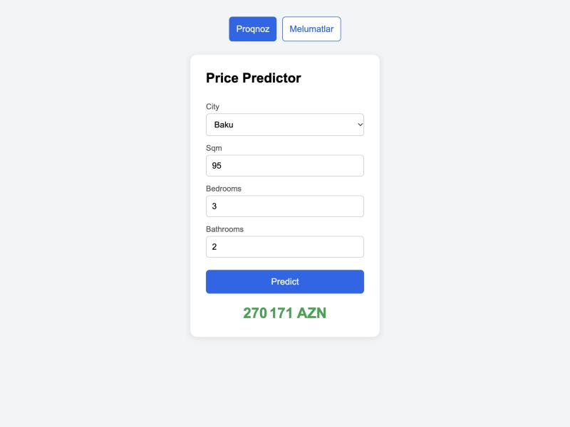
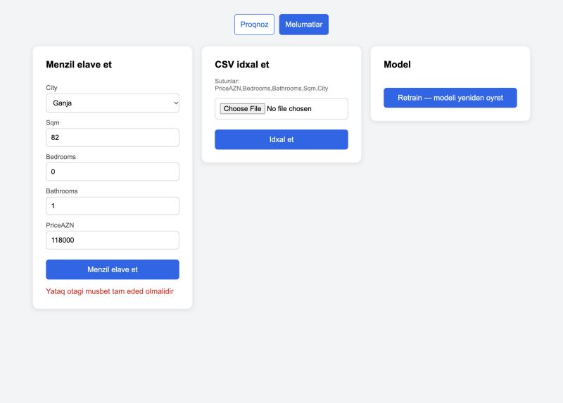
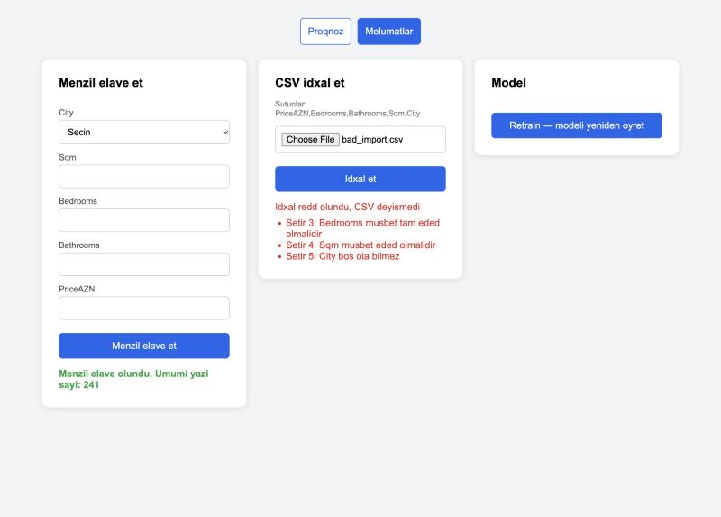
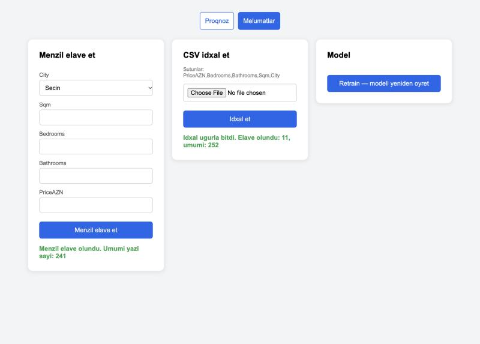
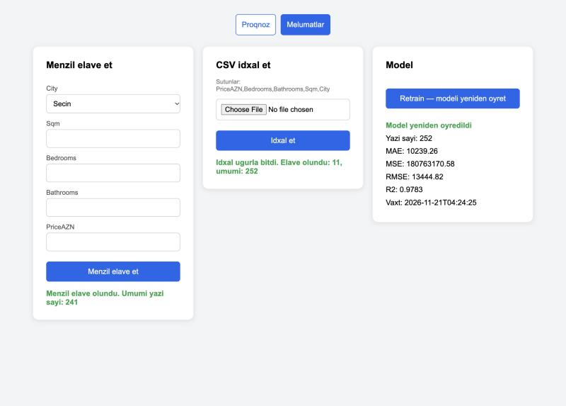
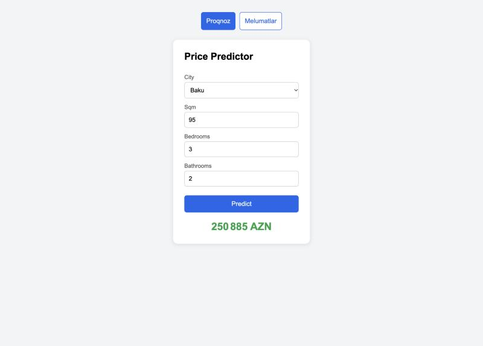

# Ders 13 - Melumatlarin elave edilmesi ve modelin yeniden oyredilmesi

Menzil qiymeti proqnozu: React -> ASP.NET Core Web API -> FastAPI -> RandomForest modeli.

```
Ders 13/
  data/housing_az_realistic.csv   esas dataset
  models/models_az.pkl            oyredilmis model
  fastapi/main.py                 FastAPI servisi
  fastapi/trainer.py              oyretme funksiyasi (retrain bunu cagirir)
  api/Program.cs                  ASP.NET Core Web API
  react/                          React (Vite)
  sample_import.csv               idxal ucun numune (11 setir)
  bad_import.csv                  sehv CSV numunesi
```

## Ise salma

1. FastAPI (port 8000)

```bash
cd "Ders 13"
python3 -m venv .venv
.venv/bin/pip install -r fastapi/requirements.txt
.venv/bin/python fastapi/trainer.py
cd fastapi
../.venv/bin/uvicorn main:app --port 8000
```

`trainer.py` bir defe ise salinir ve `models/models_az.pkl` faylini yaradir.

2. ASP.NET Core Web API (port 5000, .NET 9)

```bash
cd "Ders 13/api"
dotnet run
```

3. React (port 5173)

```bash
cd "Ders 13/react"
npm install
npm run dev
```

Sayt: http://localhost:5173

## Endpoint-ler

| Emeliyyat | ASP.NET | FastAPI |
|---|---|---|
| Proqnoz | POST /api/AI/predict | POST /predict |
| Menzil elave et | POST /api/AI/apartments | POST /apartments |
| CSV idxal et | POST /api/AI/apartments/import | POST /apartments/import |
| Modeli yeniden oyret | POST /api/AI/retrain | POST /retrain |

Menzil elave et (JSON):

```json
{ "city": "Ganja", "sqm": 82, "bedrooms": 2, "bathrooms": 1, "priceAZN": 118000 }
```

Cavab: `{ "message": "Menzil elave olundu", "added": 1, "total": 241 }`

CSV idxal: `multipart/form-data`, sahe adi `file`.

Cavab: `{ "message": "Idxal ugurla bitdi", "added": 11, "total": 252 }`

Sehv olanda (CSV deyismir):

```json
{ "detail": { "message": "Idxal redd olundu, CSV deyismedi", "errors": [ { "row": 3, "error": "Bedrooms musbet tam eded olmalidir" } ] } }
```

Retrain cavabi:

```json
{ "message": "Model yeniden oyredildi", "rows": 252, "metrics": { "mae": 10239.26, "mse": 180763170.58, "rmse": 13444.82, "r2": 0.9783 }, "trainedAt": "2026-11-21T04:24:25" }
```

## Idxal ucun CSV numunesi

```
PriceAZN,Bedrooms,Bathrooms,Sqm,City
250000,3,2,110,Baku
145000,2,1,85,Sumqayit
98000,2,1,72,Ganja
```

## Qaydalar

- Bedrooms ve Bathrooms musbet tam eded, Sqm ve PriceAZN musbet eded, City bos olmamalidir.
- Yoxlama React, ASP.NET ve FastAPI terefinde aparilir.
- Yeni setirler faylin sonuna yazilir, basliq tekrar yazilmir.
- CSV-de en azi bir setir sehvdirse butun idxal redd olunur.
- CSV yazilmasi ve oxunmasi lock ile edilir, fayl evvelce `.tmp` fayla yazilib sonra evez olunur.
- Eyni anda ikinci retrain 409 qaytarir.
- Oyretme alinmasa kohne model qalir. Yeni model `/predict` ucun server yeniden baslamadan istifade olunur.
- Melumat elave etmek modeli avtomatik oyretmir, yalniz Retrain duymesi ile.
- FastAPI islemirse ASP.NET 503, vaxt bitende 504 qaytarir.

## Ekran goruntuleri

Ilkin proqnoz:



Sehv forma redd olunur:



Menzil elave olundu:


Sehv CSV redd olundu:



CSV idxal olundu (11 setir):



Retrain ve metrikalar:



Server yeniden baslamadan yeni proqnoz:


